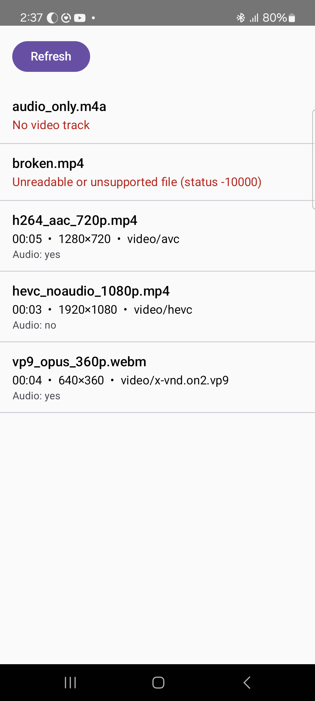

# Video Metadata Catalog

Lists the video files in a folder owned by a service and shows each file's duration, dimensions,
video MIME type and whether it has audio.

```
Client (UI) → AIDL → CatalogService (:metadata) → JNI → NDK AMediaExtractor → back to the UI
```



## Build

- Android Studio 2025.3.4+ or JDK 17+. The NDK (r30) and CMake are downloaded by Gradle on the first build.
- Device or emulator with Android 7.0 (API 24) or newer.

```bash
./gradlew installDebug
```

On macOS without a system JDK: `export JAVA_HOME="/Applications/Android Studio.app/Contents/jbr/Contents/Home"` first.

## Run and demo

Launch **Video Catalog**. The service copies the bundled samples into its private folder on first
use and the list appears. **Refresh** re-runs the scan.

| File | Shown |
|---|---|
| `audio_only.m4a` | error: No video track |
| `broken.mp4` | error: Unreadable or unsupported file |
| `h264_aac_720p.mp4` | 00:05 • 1280×720 • video/avc • Audio: yes |
| `hevc_noaudio_1080p.mp4` | 00:03 • 1920×1080 • video/hevc • Audio: no |
| `vp9_opus_360p.webm` | 00:04 • 640×360 • video/x-vnd.on2.vp9 • Audio: yes |

Two processes: `adb shell ps -A | grep videocatalog` lists `com.example.videocatalog` and
`com.example.videocatalog:metadata` while the app is open. The client also logs both pids
(`adb logcat -s MainActivity`).

## Structure

| File | Responsibility |
|---|---|
| `IVideoCatalog.aidl`, `VideoInfo.aidl` | Contract: `List<VideoInfo> listVideos()`; `VideoInfo` is a Kotlin `@Parcelize` data class. |
| `service/CatalogService.kt` | Runs in `:metadata`. Owns `filesDir/videos`, copies the samples once, calls native code per file. |
| `service/NativeExtractor.kt` | Loads `libvideometa.so`, declares `extractVideoMetaData(path): VideoInfo`. |
| `cpp/videometa.cpp` | Opens the file, reads track formats with `AMediaExtractor`, builds the `VideoInfo`. |
| `ui/` | `MainActivity` binds/unbinds the service and calls it off the main thread; Compose screen with loading / error / empty / list states. |

## Design decisions

- **One APK, two processes.** `android:process=":metadata"`, `exported="false"`, bound with an explicit intent in `onStart`, unbound in `onStop`.
- **The service owns the folder.** Videos live in `filesDir/videos`; the AIDL contract carries no paths or file descriptors. Samples are copied from `assets/` once, on the first `listVideos()` call (binder thread, not the main thread).
- **Minimal contract.** One synchronous call returning the whole list. Per-file problems go into `VideoInfo.error` so one bad file never fails the call.
- **Kotlin `@Parcelize` model** instead of an AIDL structured parcelable: immutable fields and real nullability. JNI calls its full constructor.
- **JNI: path in, object out, one call per file.** Kotlin lists and sorts the folder; C++ only does what Kotlin cannot. Every lookup is null-checked, strings and local refs are released on every path, exceptions propagate to a `catch` in the service.
- **NDK:** `AMediaExtractor_setDataSourceFd` on a descriptor the native code opens itself (the path overload is URI-based and fails for local files). First `video/` track gives MIME, size and duration; all tracks are scanned for `audio/`; every format and the extractor are freed.
- **No ViewModel, DI or repository.** One screen, one source, one call. The Activity holds a `sealed interface UiState`; a config change re-binds and re-scans, which is cheap here.

## Sample files

Generated with ffmpeg from synthetic sources, so they are tiny and license-free. Each covers a distinct case:
H.264+AAC MP4 (common case), HEVC without audio (other MIME, `hasAudio = false`), VP9+Opus WebM
(other container), audio-only M4A (no video track error), and 4 KB of random bytes (unreadable file error).

## Limitations

- Both processes share the app UID, so isolation is architectural; strict isolation needs a separate service APK.
- Dimensions are the coded size; the rotation flag is ignored.
- The folder is scanned in one synchronous call and one Parcel; large folders would need paging.

## AI tools

An AI assistant generated the project skeleton and build configuration, answered API questions
with links to the official docs and reviewed the code against an IPC/JNI/NDK checklist. All
decisions and code were verified by building and running on a device.
